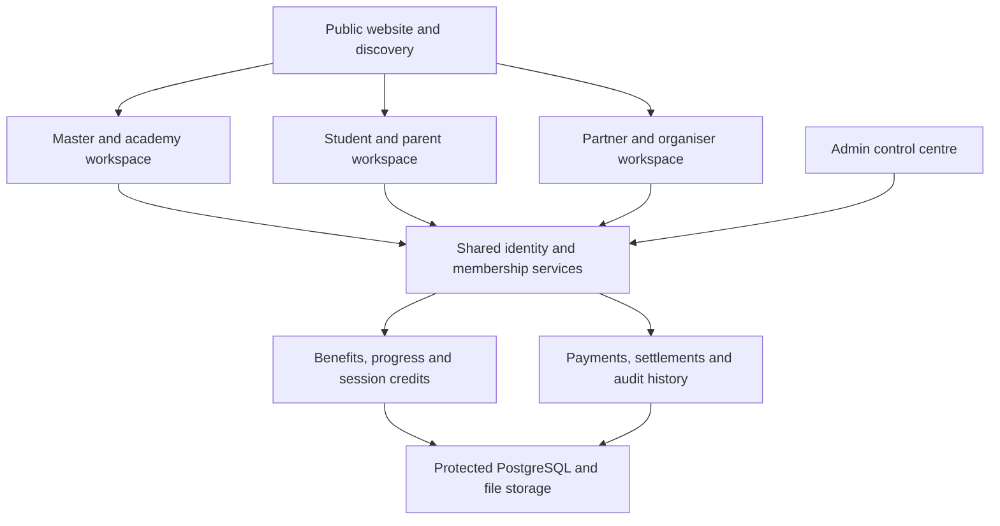

# MastersCorner — Integrated Platform Architecture

Professional Membership Card · Student Passport · Experience Cards

Version 2 | 17 October 2026 | Proposed product and development blueprint

Based on the [shared MastersCorner architecture](https://chatgpt.com/share/6ad366dd-5d78-83ee-8d99-07d2afb7bb34), extended with the Professional Membership Card and Student Passport. This is a specification for development; it does not indicate that software, partnerships or benefits are already operational. The standalone development prompt at the end can be used in another ChatGPT account.

## 1. One platform, three connected products

MastersCorner is an independent martial-arts business network connecting masters, academies, students, parents, schools, organisers and commercial partners. Masters retain their academy identity, style, lineage, association, grading authority and student relationships. SHA can be a pilot academy; other academies receive the same tenant protections.

| Product | What the customer buys | Physical and digital format | What it does not automatically include |
|---|---|---|---|
| Professional Membership | A time-limited professional benefits and tools plan for a master | Named membership card with QR, digital card and master workspace | Rank certification, association affiliation, guaranteed leads, jobs or income |
| Student Passport | A persistent student progress identity, with an optional annual benefits plan | Named passport card with QR, digital progress record; optional printed milestone booklet | Unlimited classes, automatic tournament eligibility, recognised belt equivalence or universal concessions |
| Experience Card | A prepaid package of defined introductory sessions | Digital booking credits; optional printed gift voucher | Professional membership, an ongoing academy enrolment, or a complete training history |

The physical cards are tangible access points to useful services. The value comes from delivered tools, records and benefits. Keep student identity/history separate from the annual benefit subscription: an expired benefit plan does not erase training history.

Professional Membership replaces overlapping generic paid-master subscriptions in the earlier plan. Avoid charging twice for the same tools. Larger academy/team plans can be an explicitly separate upgrade for more branches, seats or functionality.

## 2. Connected architecture

Use a single full-stack application and database with clear modules. A master who is also a parent can use one login and switch roles. A child can have a passport without an independent login; authorised guardians manage access.

## 3. Professional Membership Card

### Member experience

Application → identity/profile checks → approve membership eligibility → verified payment or approved complimentary grant → activate plan → issue digital card → print and dispatch physical card → use benefits → review value → renew.

Payment does not establish a professional qualification. Record identity checks and credential checks separately. If a payment is accepted before approval, define rejection/refund handling before selling.

| Benefit | Member outcome | How MastersCorner makes it deliverable | Launch treatment |
|---|---|---|---|
| Professional profile and card | A consistent identity and discoverable services | Profile editing, public visibility controls, QR validity page | Launch |
| Enquiry and trial tools | Follow-ups and conversions recorded in one place | CRM, reminders, trial attendance and conversion history | Launch |
| Resource library | Less time preparing academy communications and operations | Reviewed templates, version dates, access permissions | Launch with a small useful set |
| Member community and learning | Access to peer support and practical learning | Published calendar, moderator and session owner | Launch only with an operating schedule |
| Opportunities | Apply for coaching, refereeing, judging and school assignments | Verified listings, requirements, applications and assignment status | Pilot manually; no work guarantee |
| Event and equipment offers | Savings on eligible purchases | Signed partner terms, validity, exclusions, caps and redemption process | Show only active offers |
| Academy mini-website | A maintained public page for the academy | Defined template, included limits and support responsibility | Phase 2 or separate upgrade |
| Recognition and service record | Evidence of contributions and participation | Issuer-approved records and correction process | Phase 2 |

Use distinct badges: identity checked, specified credential checked, and membership active. Each badge describes exactly what was checked. Buying a card must never produce a verified-rank badge.

### Card content

Front: MastersCorner brand, member photo, name, professional member number, member category and expiry. Back: QR, verification/support address and short membership terms. Academy and style can appear with permission. Avoid printing claims about rank verification without evidence.

## 4. Student Passport

The passport follows the student across authorised academy relationships. Academy enrolments remain separate. A student can learn Karate at one academy and Silambam at another while keeping one passport identity.

### Passport sections

| Section | Records | Who records or confirms it |
|---|---|---|
| Identity | Passport ID, preferred name, guardian links and optional photo | Guardian/student plus permitted staff |
| Academy relationships | Academy, branch, program, enrolment dates and status | Relevant academy |
| Training progress | Attendance, skill milestones and drill achievements | Instructor within the relevant academy |
| Grades and certificates | Style, rank, issuer, grading date and evidence | Issuing academy/organisation; verification status shown separately |
| Events | Entry, participation, results and supporting evidence | Authorised organiser or academy; evidence provenance retained |
| Leadership and service | Captain roles, volunteering and approved service hours | Named supervisor/issuer |
| Benefits | Eligible partner offers, expiry, limits and usage history | Membership/partner services |
| Personal portfolio | Selected certificates and shareable achievements | Student/guardian chooses visibility |

Do not merge different styles into one rank ladder. An academy-issued belt remains attributed to that academy or association; another academy decides how to recognise it. Self-submitted achievements remain labelled pending or self-reported until checked.

### Student benefits and delivery

Launch with a digital progress record, physical passport card, guardian access, achievement entries and a clear event information feed. Add tournament concessions, workshops, equipment offers and visits to partner dojos only when a named provider has agreed the actual terms. Partner visits require booking, capacity, age/level suitability and the host's acceptance.

Separate the student's permission to train, event eligibility, parental consent and payment. Holding a Passport alone satisfies none of those requirements.

### Card and privacy

Front: name, photo if consented, passport number, optional home academy. Back: QR, support address and a short description of the passport. Keep the stable identity distinct from any annual benefits expiry.

A public scan should show only consented identity fields and minimal status. Never expose a child's date of birth, phone, home address, medical notes or attendance schedule through the public QR. Emergency information, if collected, belongs behind a narrowly authorised workflow.

## 5. Experience Cards remain a separate purchase

Preserve the original introductory-session concept. A configurable package defines eligible academies, sessions/credits, validity, booking conditions, cancellation, no-shows, refunds and provider compensation.

Example journey: a parent buys an Experience Card, books eligible trials, attends a session and enrols the child. The system links or creates one student identity; the academy creates its own enrolment. The parent can then activate the Student Passport benefits plan. Passport membership does not silently add session credits.

The earlier ₹999/six-credit package and ₹200–₹300 attended-trial fee remain unvalidated hypotheses. Do not hard-code them. For each booking define whether the platform earns a package margin, a trial fee or another disclosed charge; prevent accidental duplicate charging.

## 6. Website and workspaces

Preserve Home, Find a Master, Academy Directory, Profiles, Classes, Events, Opportunities, For Schools, For Masters, Experience Cards and policy pages. Add Professional Membership, Student Passport, Member Benefits, Partner With Us and Card Verification.

| Workspace | Additions to the existing architecture |
|---|---|
| Master/academy | My Membership, digital card, renewals, benefits, resource library, student passport invitations, authorised progress entries, referral earnings |
| Student/guardian | My Passport, dependent switcher, academy links, progress timeline, event records, certificates, benefit eligibility, Experience Card credits, receipts and sharing controls |
| Partner/organiser | Assigned offers, eligibility checking, redemptions, authorised participation/results entry and settlement statements |
| Admin | Plans/prices, membership approvals, credential review, card fulfilment, partners/contracts, benefit publication, disputed records, refunds, renewal campaigns and reporting |

Every action needs an owner, working form, validation, persistent records, useful empty states and failure handling. Public pages can explain future features, but must label unavailable benefits clearly.

## 7. Identity, access and data ownership

- One platform person/student identity can connect to several academy enrolments. Never create a new passport for every academy.
- Do not automatically merge children by name or date of birth. Use guardian-controlled claims, invitation tokens and staff-assisted duplicate review.
- Academy staff can access their own enrolment records. Cross-academy access requires an explicit, scoped permission; a shared passport does not open another academy's private notes, fees or leads.
- Guardians see only children for whom their relationship has been authorised. Revocation and guardian changes must be supported.
- Partners see the minimum information needed for an offer or booked service. An equipment seller cannot browse student progress.
- Students/guardians control optional portfolio sharing. Temporary sharing links should expire and be revocable.
- Administrators receive limited roles for verification, support and finance; privileged actions are audited.
- Use secure authentication. Names, DOBs, member numbers and static QR codes are identifiers, not passwords.

Keep an issuer/source for every achievement. Correct disputed records by recording a correction or revocation; preserve the audit history. Define retention, export and deletion handling before production use.

## 8. Membership, QR and benefit services

### Separate state machines

| Record | Example states |
|---|---|
| Application | Draft, submitted, under review, approved, rejected |
| Subscription | Pending payment, active, expired, suspended, cancelled |
| Credential claim | Submitted, checked, rejected, expired, revoked |
| Physical card | Requested, print queued, printed, dispatched, delivered, replaced |
| Benefit redemption | Reserved, confirmed, cancelled, reversed |

Membership may activate only after both eligibility approval and verified payment, or an authorised complimentary grant. Credential review has its own status. Card printing does not control digital access. Store start/end dates, renewal history, price/benefit snapshots and administrative reasons.

### QR workflow

1. Public scans open a minimal online verification page using an opaque, revocable card token.
2. A signed-in partner selects the intended offer. The server checks member identity, active dates, offer dates, branch eligibility, limits and partner permission.
3. A staff confirmation or member confirmation completes redemption. Use a short-lived member confirmation for benefits with meaningful value; a photographed static QR alone is insufficient.
4. Save redemption, usage counters and any settlement obligation atomically, with a unique request key to prevent duplicates.
5. Return a receipt/status and preserve reversals as new records.

Expiry, suspension, cancellation and card replacement affect eligibility immediately online. A lost card can be revoked and replaced without changing the person's underlying identity. Do not support offline value redemption in the first release.

## 9. Database additions

Retain the shared architecture's profiles, scoped user roles, masters, academies, branches, styles, programs, classes, enquiries, activities, trials, students, enrolments, attendance, events, opportunities, Experience Cards, payments, payouts, reviews, websites, school requests, notifications and audit history.

| Additional table/module | Purpose and key relationship |
|---|---|
| `academy_memberships` | Users/staff → academy/branch → scoped role; distinct from paid membership |
| `student_guardians` | Guardian profile → student, authorisation status and permissions |
| `membership_plans`, `plan_versions` | Master/student products, price and benefit definitions over time |
| `membership_applications` | Applicant, plan version, eligibility decision and reviewer |
| `subscriptions` | Master/student → plan version, start/end, payment/grant and status |
| `student_passports` | One stable passport identity per platform student; independent of subscription |
| `credential_claims`, `credential_reviews` | Master credentials, issuer, evidence, reviewer and outcome |
| `issued_cards`, `card_fulfilments` | Holder, revocable token hash, card version, print and dispatch status |
| `partners`, `partner_staff`, `partner_agreements` | Provider identity, permissions and signed commercial terms |
| `benefits`, `plan_benefits` | Offer provider, eligible plan, dates, quota, exclusions and funding party |
| `benefit_redemptions` | Member, offer, provider, time, value, status and idempotency key |
| `progress_entries`, `student_credentials` | Student, academy/style, issuer, evidence and verification/correction state |
| `service_records` | Approved volunteer roles, supervisor and service hours |
| `consents`, `record_access_grants` | Purpose-specific consent and scoped cross-academy/portfolio access |
| `orders`, `order_lines`, `payment_events`, `refunds` | Purchases, line items, provider events and corrections |
| `ledger_entries`, `settlement_lines` | Money allocation, partner/master obligations, reversals and reconciliation |
| `referrals`, `commission_rules`, `referral_commissions` | Attributed sales, versioned terms, eligibility and payout history |
| `resource_documents` | Versioned member resources and access entitlement |

Use foreign keys and uniqueness constraints. Add academy ownership to tenant business records, while protecting shared person/passport tables through explicit relationships. Store money as integer paise with currency and financial records as append-only/reversal-based history.

Separate prepaid credit accounting from membership entitlement and cash accounting. Experience Card credits need grant, reserve, consume, release, expire and refund movements, not just an editable balance.

## 10. Revenue and partner economics

Professional Membership is the core paid-master plan. Student Passport can have an annual benefits fee, with issuance/replacement/delivery charges disclosed separately. Persist price versions so existing members keep the terms they purchased.

Keep website upgrades, school-program services, events, prepaid sessions and marketplace transactions as separate, clearly priced purchases. The free/basic discovery profile can remain available, so a master pays for an actual bundle of services.

For partner benefits record: who funds the discount, list price, customer payment, provider entitlement, MastersCorner fee, applicable tax treatment, settlement period, refund allocation and maximum liability. Confirm tax/payment arrangements for the actual operating business before live collection.

Referral commissions are optional commercial proposals, not promises to participating masters. Accrue a commission only after verified collection and the agreed eligibility/refund conditions; reverse it when required. Do not treat collected money owed to partners as platform profit.

Membership contribution calculation: collected membership revenue, less applicable tax, payment fees, physical card/delivery, referral share, funded benefits, support and refunds. Keep revenue recognition over the service term distinct from upfront cash collection. Set final prices after measuring these costs in the pilot.

## 11. Delivery roadmap

These are completion gates, not guaranteed calendar estimates. Launch in one city with roughly 5–10 willing masters and a manageable student cohort before expanding.

| Gate | Build and operating work | Evidence required before proceeding |
|---|---|---|
| 0 — Offer readiness | Define two membership offers, fulfilment owner, benefit owners, sample cards, renewal/refund rules and partner terms | Every advertised launch benefit has a provider, process and capacity |
| 1 — Foundation | Auth, roles, tenant boundaries, profiles, directory, branches, verification and persistent enquiries | Users can create records; unauthorised cross-academy access is denied |
| 2 — Membership and Passport | Guardian links, plan versions, memberships, digital cards, manual fulfilment queue, progress entries and verification pages | Issue, expire, renew and replace cards; private child data stays private |
| 3 — Paid pilot and benefits | Verified payments/refunds, partner offers, online redemption, receipts and simple settlement reports | Duplicate payments/redemptions cause no duplicate benefits or obligations |
| 4 — Growth workflows | Full CRM/trials, Experience Cards, bookings, event records, opportunities, referrals and mini-sites | End-to-end enquiries, bookings, credits, refunds and payouts reconcile |
| 5 — Expansion | School partnerships, more partners/cities, automation and operational reporting | Proven member usage, renewals, sustainable margins and reliable support |

Maintain master renewals, student benefit renewals, enquiry conversion, passport usage, benefit usage, fulfilment time, partner liabilities and contribution per member. Report gross collections, platform revenue and profit separately.

## 12. Required acceptance checks

1. A master applies, is reviewed, pays in test mode, receives an active digital card, and appears in the correct fulfilment queue.
2. A successful browser redirect without a verified payment cannot activate membership; duplicate/out-of-order provider events are reconciled safely.
3. A guardian can manage two children; another guardian cannot access either child without authorisation.
4. One child can hold two academy enrolments and one passport; each academy sees only its own permitted records.
5. A public QR exposes only approved minimal fields and cannot edit records or redeem an offer.
6. Concurrent redemption requests cannot exceed an offer quota. Suspended or expired membership fails eligibility checks.
7. A replaced card stops working while the replacement refers to the same member identity.
8. A student plan expires while authorised historical passport access and academy records remain intact.
9. A grade records its issuer/style; another academy cannot silently rewrite it. Corrections retain history.
10. Cancellation/refund reverses eligible credits, benefits or commissions under the purchased terms, without deleting financial history.
11. Experience credits are reserved/consumed/released correctly, and each booking creates the intended provider obligation once.
12. Admin reports reconcile orders, provider collections, refunds, platform revenue and outstanding settlements.

## 13. Implementation foundation

Preserve the proposed Next.js + TypeScript application, Tailwind/shadcn UI, Supabase PostgreSQL/Auth/Storage, GitHub source control and Vercel deployment. This is a proposed stack, subject to the implementation environment and current official documentation. Use one maintainable application rather than separate membership, passport and marketplace codebases.

Enforce server-side validation and database access rules. Supabase documents database-level Row Level Security and the need to configure grants and policies together: [official RLS guide](https://supabase.com/docs/guides/database/postgres/row-level-security). Keep privileged keys server-side and test allowed and denied access.

For Razorpay integration, verify webhook signatures and handle repeated/out-of-order events using provider identifiers and authoritative payment state: [official webhook validation guide](https://razorpay.com/docs/webhooks/validate-test/). Payment, membership activation, commission accrual and fulfilment creation must each be idempotent.

Use private storage for credentials, consent documents and non-public certificates. Public profile assets require explicit publication. Audit privileged changes. Provide migrations, environment variable examples without secrets, seed data clearly marked for development, test instructions and deployment documentation.

## 14. Standalone development prompt

Copy everything below into the account that will build MastersCorner. This prompt incorporates the original platform scope and the membership/passport additions.

---

Act as my CTO, product manager, senior full-stack engineer, database architect and QA engineer. Build MastersCorner as a persistent, secure, multi-academy martial-arts business network. Implement incrementally and report honestly what is implemented and tested.

### Product boundaries

MastersCorner is independent of SHA Martial Arts Academy. SHA may be a pilot tenant. Every academy retains its brand, style, lineage, association, grading authority and student relationships. Support masters, academy owners/managers, instructors, students, authorised guardians, schools, partners, event organisers and scoped platform operations/finance/verification administrators. Users may hold multiple authorised roles.

Integrate three distinct products:

1. Professional Membership: a paid, time-limited benefits/tools plan for masters, with physical and digital QR cards. Use this as the main paid-master subscription rather than introducing duplicate fees for the same tools.
2. Student Passport: one persistent student training identity and portfolio, plus a separate optional annual benefits subscription and physical/digital card. Benefit expiry must not erase the passport's training history.
3. Experience Cards: separately purchased, configurable prepaid introductory-session packages. They have their own credit ledger, booking rules, refunds and provider settlement obligations.

Membership status, identity verification, credential verification, event eligibility and academy enrolment are separate concepts. A purchase does not establish rank, affiliation or competition eligibility. Cross-academy recognition and concessions require the relevant provider's acceptance.

### Technical foundation

Prefer Next.js App Router, TypeScript, Tailwind, shadcn/ui, Supabase PostgreSQL/Auth/Storage, GitHub and Vercel where available. Inspect the actual environment first and consult current official documentation for implementation APIs. Use migrations, server-side validation, tenant-scoped roles, database grants/RLS, private file access and secure authentication. Never expose privileged keys or use name/DOB/member number as a password.

Use a single full-stack application with modules for identity/access, directory, academy operations, membership/cards, passport/progress, benefits, bookings/credits, events/opportunities, finance and administration. Preserve existing work after inspecting it.

### Functional public and private modules

Public: Home, Find a Master, Academy Directory, Master/Academy/Branch Profiles, Programs/Classes, Events, Opportunities, For Schools, For Masters, Professional Membership, Student Passport, Member Benefits, Experience Cards, Partner With Us, Login/Registration, Card Verification and Help/Policies.

Master/academy workspace: overview, profile/credential review, academies/branches, programs/fees, timetable, enquiry CRM, trials, students/enrolments, attendance, events, opportunities, membership/digital card/renewals, benefits/resources, student passport invitations, authorised progress entry, earnings/referrals, mini-site, notifications and settings.

Student/guardian workspace: authorised dependent management, passport/digital card, academy relationships, attendance/progress, issuer-attributed grades/certificates, event results, approved leadership/service records, membership benefits, Experience Card credits/bookings, receipts and optional portfolio-sharing controls.

Partner/organiser workspace: assigned offers and events, minimum necessary eligibility checks, online benefit redemptions, assigned result/participation entry and settlement statements. Partners must not browse unrelated student or academy data.

Admin: roles, identity/credential review, academy publishing, membership applications/plans/price versions, subscriptions, cards/fulfilment/replacements, partner agreements, benefit publication, enquiries/disputes, events/opportunities, school requests, payments/refunds, credits, commissions, reconciliation, reporting and audit history.

### Working workflows

Enquiry → follow-up history → confirmed trial → attendance/outcome → create or link student → academy enrolment. Persist each step, avoid duplicate students and retain activity history.

Membership application → approval → verified collection or approved complimentary grant → activation → digital card → tracked physical fulfilment → benefit usage → expiry/renewal. Separate credential review and fulfilment state. Activation requires eligibility plus payment/grant and must be idempotent.

Passport invitation → guardian authorisation/student claim → safe identity linking → academy enrolment relationship → issuer-attributed progress → optional benefit purchase → revocable selected portfolio sharing. Do not merge children automatically by name/DOB. Different arts retain separate rank histories. Academy staff cannot silently edit another issuer's achievements.

Experience purchase → credit grant → eligible booking → credit reservation → confirmed attendance/consumption or cancellation/release → provider settlement → enrolment conversion if applicable. Distinguish prepaid credits, membership benefits and cash ledgers.

QR scans resolve a minimal public validity page using opaque revocable card tokens. Static QR codes do not authenticate a member or authorise redemption. Signed-in partner redemption requires the correct partner/offer, membership and offer validity, quota checks and member confirmation where appropriate. Use transactions and unique request keys to prevent duplicate/excess redemption. Support revocation/replacement; do not implement offline value redemption initially.

### Data model

Retain profiles, scoped user roles, masters, academies, branches, master-academy links, styles, programs, classes, students, enquiries/activities, trials, enrolments, attendance, events/registrations, opportunities/applications, Experience Cards, payments/payouts, reviews, websites, school requests, notifications and audit history.

Add academy staff memberships; guardian-student authorisations; membership plans and versions; applications and subscriptions; stable student passports; credential claims/reviews; issued cards and fulfilments; partners/staff/agreements; benefits/plan assignments/redemptions; issuer-attributed progress/student credentials; service records; purpose-specific consents and record-access grants; orders/lines/payment events/refunds; financial ledger and settlement lines; referrals/commission rules/commissions; versioned resources; and Experience Card credit movements.

Use foreign keys, ownership fields, indexes, constraints and timestamps. Store money as integer paise with currency. Preserve purchased pricing/benefit terms. Financial corrections use reversal records. One passport identity may have multiple protected academy enrolments. Design retention, exports and deletion handling explicitly.

### Commercial rules

All prices, durations, commissions, benefit limits and partner terms are configurable and versioned. The earlier ₹999/six-credit and ₹200–₹300 attended-trial ideas are hypotheses, not production prices. Avoid duplicate trial/package fees and overlapping subscription charges. Do not advertise uncontracted discounts or guaranteed jobs, income, ranks, insurance or tournament access.

For each offer/booking record who funds the benefit, provider entitlement, platform fee, refund allocation and settlement timing. Separate gross collection, platform revenue, liabilities and profit. Accrue referral rewards only under approved terms after verified collection, and reverse them when required.

Verify payment provider signatures and authoritative payment state. Safely handle repeated/out-of-order payment events. A browser success redirect alone must never activate access. Make activation, credit grants, fulfilment requests and settlement creation idempotent.

### UI, security and quality

Provide responsive, accessible pages, useful empty states, persistent forms, validation, search/filters and clear errors. Every enabled button must perform its stated action. Label unavailable features and development seed data. Never substitute browser-only state for database persistence.

Public child-card scans must never reveal DOB, address, phone, medical notes, schedule or private progress. Guardian access requires authorisation. Academy A cannot access Academy B's private notes, leads, finance or enrolment details just because both teach one student. Shared progress access must be explicitly scoped and revocable. Test both allowed and denied access for every role, including database/API paths and private storage.

### Delivery sequence and acceptance

First inspect the environment, propose folders/database relationships, list required setup and environment variables without secrets, and identify acceptance checks. Then build in milestones:

1. Foundation: secure auth/roles/RLS, profiles, academies/branches, public directory, verification queue, persistent enquiry submission and CRM listing. Model the identity/guardian/membership/passport relationships now so later milestones do not require duplicate identities.
2. Membership/Passport: applications/plans/subscriptions, guardian linking, digital card/verification, stable passports, progress entries, expiry/renewal/replacement and manual physical fulfilment.
3. Paid pilot: payment/refund integration, live eligibility, contracted partner offers, atomic redemption, receipts and reconciliation.
4. Growth: full CRM/trials/enrolments/attendance, Experience Card credit ledger/bookings, events/results, opportunities, commissions and mini-sites.
5. Expansion: schools, notifications, more partner/city operations and reporting after pilot validation.

For each milestone deliver actual source changes, migrations/policies, meaningful workflow/security tests, run/deploy instructions, validation results and an honest unfinished-items checklist. Confirm duplicate payment/redemption handling, guardian isolation, cross-academy isolation, expiry/history retention, card revocation and refund/settlement reconciliation before considering the relevant module complete.

Start with the architecture and first milestone implementation. Do not attempt the entire marketplace in one generation or claim deployment without an actual tested deployment.

---
